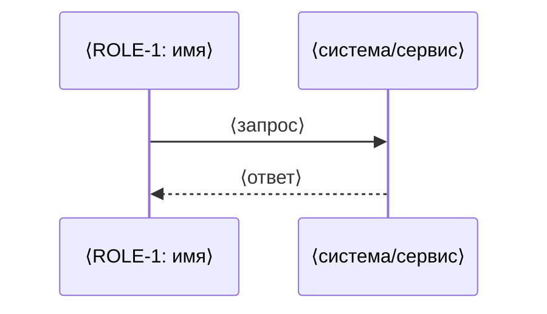

> Статус: черновик

# PROC-N. ⟨название процесса⟩

**← истории:** USRSTR-1
**← роли:** ROLE-1, ROLE-2
**← агрегаты:** AGGR-1

## Триггер

⟨что запускает процесс⟩

## Предусловия

- ⟨что должно быть верно до начала⟩

## Диаграмма последовательности

## Основной сценарий

1. ⟨шаг⟩
2. ⟨шаг⟩

## Альтернативные ветки и отказы

Самая ценная часть документа: успешный путь придумывается сам, отказы — нет.

| Условие | Что происходит | Что видит инициатор |
|---|---|---|
| ⟨отказ⟩ | ⟨поведение⟩ | ⟨результат⟩ |

## Постусловия

- ⟨что стало верно после успешного завершения⟩
