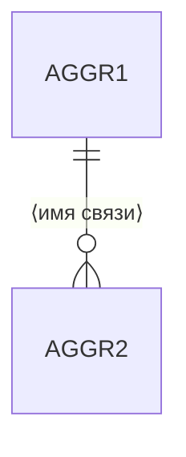

> Статус: черновик

# Связи

## Между агрегатами

| № | От | К | Кратность | Владение | ← обоснование |
|---|---|---|---|---|---|
| REL-1 | AGGR-1 | AGGR-2 | 1 : N | AGGR-2 не существует без AGGR-1 | USRSTR-3 |

## Между ролями

| № | От | К | Тип | ← обоснование |
|---|---|---|---|---|
| REL-2 | ROLE-1 | ROLE-2 | включает права / исключает / подчинение | USRSTR-5 |

## Схема

## Догадки

Связи, которые не следуют напрямую ни из одной истории, — здесь, явным списком.
Сама связь стоит и в таблице выше, с `‼ (Q-N)` в столбце обоснования.

- REL-N — ⟨почему считаем, что связь есть, и что нужно уточнить⟩

## Удалённые элементы

Номера не переиспользуются.

| № | Что было | Удалено | Причина |
|---|---|---|---|
